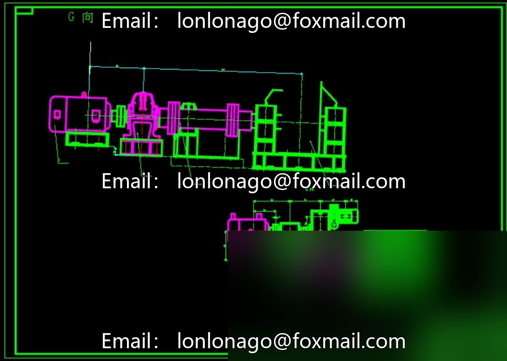
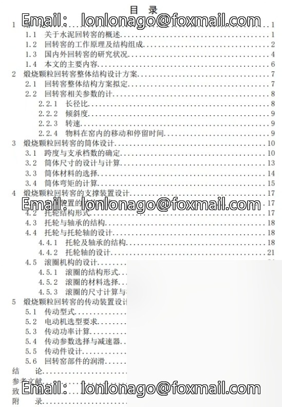
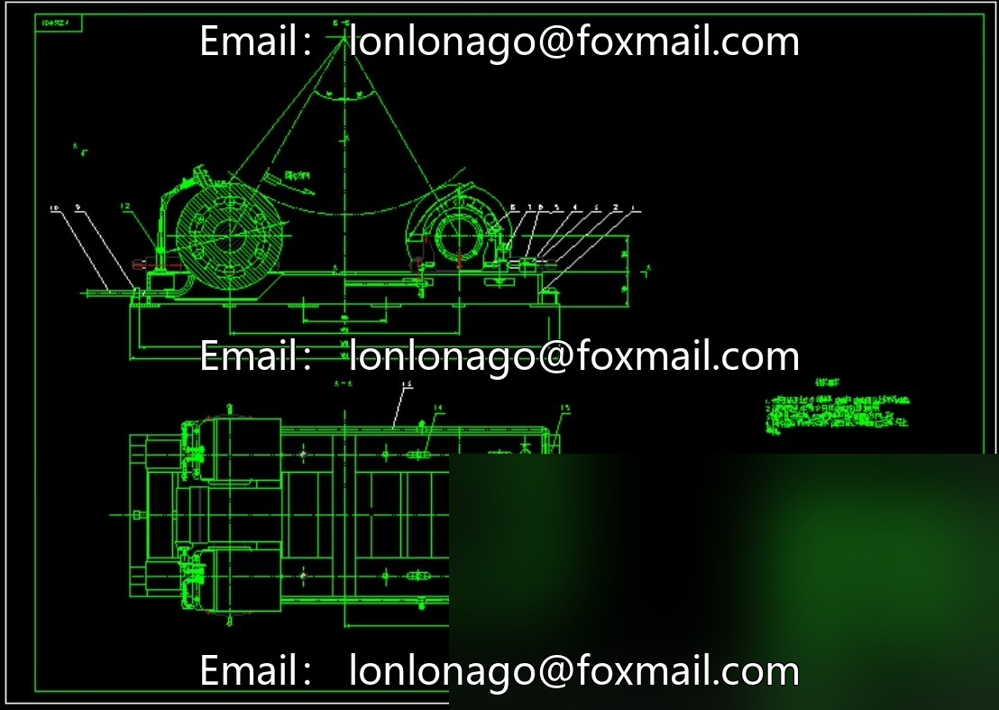

# Rotary kiln design; cement rotary kiln design; cement rotary kiln CAD drawings; cement rotary kiln drawings

## Body

Rotary kiln design; cement rotary kiln design; cement rotary kiln CAD drawing; cement rotary kiln drawing
439 This design is a design for a calcined particle cement rotary kiln, including a manual and CAD drawings; please refer to the figures for specific details

The design covers cement rotary kiln design, CAD diagrams and related structures, including process overview, structural design schemes, size calculations, material selection and multiple drawing types.

<!-- AI_ENRICHED -->

## Images

## Payment

Here is a pay link on Stripe ( https://buy.stripe.com/3cs8yP7sY87d0vu9AB ). Please contact me lonlonago@foxmail.com after funding $89, and I will send you a complete data files , thank you!

